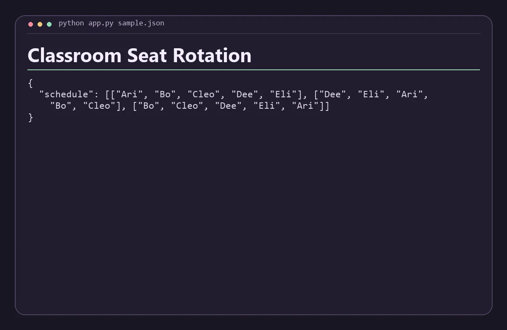

# Classroom Seat Rotation

Build a repeatable seat rotation that lets each participant use every numbered seat once per cycle.



## Run

Install Python 3.11 or newer. Run these commands from the repository root.

```sh
python app.py sample.json
```

Replace `sample.json` with a JSON file following the same structure. The app prints a JSON report to standard output.

List unique participants in starting seat order. Choose a positive step coprime to the number of participants so a full cycle covers every seat.

## Verify

Run `python check.py` with Python 3.11 or newer after the build step when applicable. The check verifies the bundled scenario and confirms that an invalid input returns an error.
